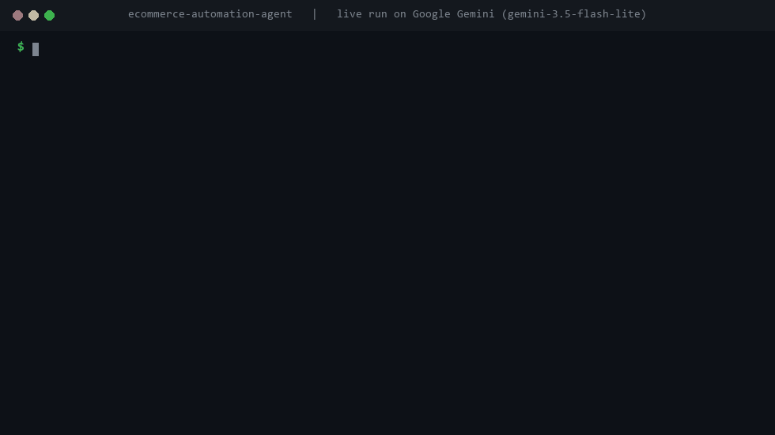

<h1>E-commerce Order and Inventory Agent</h1>

<b>A support agent that answers order, stock and return questions from real store data, plus a separate monitor that warns you before a product runs out.</b>

  
  
  
  
  
  

  <a href="#what-it-does">What it does</a> &nbsp;|&nbsp;
  <a href="#how-it-works">How it works</a> &nbsp;|&nbsp;
  <a href="#sample-run">Sample run</a> &nbsp;|&nbsp;
  <a href="#quick-start">Quick start</a> &nbsp;|&nbsp;
  <a href="#configuration">Configuration</a> &nbsp;|&nbsp;
  <a href="#roadmap">Roadmap</a>

 

<h2>See it in action</h2>

Recorded from a real run on Google Gemini (<code>gemini-3.5-flash-lite</code>) on 13 November 2026. Nothing is edited or scripted. Only the waiting time while the model thinks is shortened. <a href="demo/demo.mp4">Download the MP4</a>.

<h2>The problem</h2>

In a small online store, "where is my order", "is this in stock" and "can I return this" make up most of the support inbox. The questions repeat, the answers sit in the store data, and someone still types them out by hand.

Running out of a popular product is a quieter problem. Nobody asks a question that would surface it, so someone usually notices a few days late, after the sales are already lost.

<h2>What it does</h2>

<table>
  <tr><th align="left">Capability</th><th align="left">What that means in practice</th></tr>
  <tr><td><b>Order status</b></td><td>Looks up an order by ID and tells the customer exactly where it is.</td></tr>
  <tr><td><b>Stock questions</b></td><td>Matches a product from a normal sentence, like "is the wool throw in stock", and answers with the live quantity.</td></tr>
  <tr><td><b>Returns checked against policy</b></td><td>Return requests are checked against the store's return window and order status in code before the agent agrees to anything.</td></tr>
  <tr><td><b>Escalation</b></td><td>Complaints and upset customers go to a person with a ticket number, not an AI guess.</td></tr>
  <tr><td><b>Low-stock monitor</b></td><td>A separate job scans inventory and posts an alert to Slack before items run out. No customer involved.</td></tr>
  <tr><td><b>Works with a real Shopify store</b></td><td>Add two environment variables and every lookup switches from local demo data to the Shopify Admin API. No code changes.</td></tr>
</table>

<h2>How it works</h2>

<pre>
customer message --&gt; classify --+--&gt; order_status  --&gt; Shopify order lookup
                                +--&gt; stock_check   --&gt; product match + inventory
                                +--&gt; return_refund --&gt; policy check in code
                                +--&gt; escalate      --&gt; ticket for a person

stock_monitor.py (on a schedule) --&gt; scan inventory --&gt; Slack alert
</pre>

<code>app.py</code> is the customer-facing side: a LangGraph graph that classifies each message and routes it to one of four handlers. <code>stock_monitor.py</code> is the proactive side: a script meant to run on a schedule. Both share the same data layer in <code>agent/shopify_client.py</code>.

The return policy lives in <code>data/store_policy.json</code>, not in the code. A new store with a 14-day window instead of 30 is a one-line config change.

<h2>Decisions I made on purpose</h2>

<h3>Two problems, kept apart</h3>

Answering questions is a conversation. Watching stock is a scheduled job. Building them as one thing would have made both worse, so they are separate entry points that share one data layer.

<h3>Being upfront about a Shopify limit</h3>

Shopify has no per-product low-stock threshold, but a store owner wants different reorder points for a $12 mug and a $65 blanket. The local data supports per-item thresholds. With a live store the monitor falls back to one threshold, and on a real build I would store the per-product values in Shopify metafields.

<h2>Sample run</h2>

Order and stock answers from a real run on Google Gemini, plus the return and escalation paths:

<pre>
$ python app.py
You: Where is order ORD-3001?
Agent [order_status]: Order ORD-3001 (Cedar Ceramic Mug, Cedar Soy Candle) is currently Delivered.

You: is the wool throw blanket in stock?
Agent [stock_check]: Cedar Wool Throw Blanket: In stock (6 left)

You: I want to return ORD-3004
Agent [return_refund]: Order ORD-3004 was placed 114 days ago, which is outside
our 30-day return window. I'll escalate this in case an exception applies.

$ python stock_monitor.py
Low stock alert, Cedar &amp; Co.
- Cedar Wool Throw Blanket (CEDAR-THROW-02): 6 left, threshold is 10
- Cedar Soy Candle (CEDAR-CANDLE-03): 3 left, threshold is 20
</pre>

<h2>Quick start</h2>

You need Python 3.12 or newer and an API key from OpenAI, Anthropic or Google Gemini.

<pre>
pip install -r requirements.txt
cp .env.example .env        # on Windows: copy .env.example .env
# open .env and paste your API key
python app.py              # chat with the support agent
python stock_monitor.py    # run the low-stock check once
</pre>

Without Shopify settings everything runs on the demo store in <code>data/</code>. The demo orders store their dates as "days ago", so the examples above give the same answers whenever you run them.

<h2>Configuration</h2>

Everything is set in <code>.env</code>. Copy <code>.env.example</code> to start.

<table>
  <tr><th align="left">Variable</th><th align="left">Required</th><th align="left">Purpose</th></tr>
  <tr><td><code>LLM_MODEL</code></td><td>Yes</td><td>Which model to use, as <code>provider:model</code>. Default <code>openai:gpt-5.5</code>. Also works with <code>anthropic:claude-opus-5-5</code> or <code>google_genai:gemini-3.5-flash</code>.</td></tr>
  <tr><td><code>OPENAI_API_KEY / ANTHROPIC_API_KEY / GOOGLE_API_KEY</code></td><td>One of them</td><td>The key for whichever provider you picked.</td></tr>
  <tr><td><code>SHOPIFY_STORE_URL, SHOPIFY_ACCESS_TOKEN</code></td><td>No</td><td>Connects a real Shopify store through the Admin API.</td></tr>
  <tr><td><code>SHOPIFY_API_VERSION</code></td><td>No</td><td>Shopify API version, default <code>2026-04</code>. Update it when Shopify retires a version.</td></tr>
  <tr><td><code>SLACK_WEBHOOK_URL</code></td><td>No</td><td>Where low-stock alerts are posted.</td></tr>
</table>

<h2>Project structure</h2>

<pre>
ecommerce-automation-agent/
  .env.example                                           # copy to .env and add your key
  app.py                                                 # customer support chat
  case_study.md                                          # longer write-up of the design
  README.md
  requirements.txt                                       # dependencies
  stock_monitor.py                                       # low-stock check, meant to run on a schedule
  .git/
    COMMIT_EDITMSG
    config
    description
    HEAD
    hooks/applypatch-msg.sample
    hooks/commit-msg.sample
    hooks/fsmonitor-watchman.sample
    hooks/post-update.sample
    hooks/pre-applypatch.sample
    hooks/pre-commit.sample
    hooks/pre-merge-commit.sample
    hooks/pre-push.sample
    hooks/pre-rebase.sample
    hooks/pre-receive.sample
    hooks/prepare-commit-msg.sample
    hooks/push-to-checkout.sample
    hooks/sendemail-validate.sample
    hooks/update.sample
    index
    info/exclude
    logs/HEAD
    logs/refs/heads/main
    logs/refs/remotes/origin/main
    objects/03/0830eda43da2f72e1105c14aa1632a4b8bd4ae
    objects/05/9be6b2dba16839158dd877e4ca227694b27e41
    objects/0a/d7e0118665e880d9414a37297ae226a03d6ee6
    objects/0d/19a37d674a332b9dba9f34ec54f3144a81a21f
    objects/11/7e582f3e3a60902ac4b3222a66957d916138ab
    objects/1c/b1e54648029d9aae9837e7bd70e9af5bc12b00
    objects/38/1869dc8435e67cc98ec2b38cac9659a66ef744
    objects/48/46efbf80c2dc18bca582aed767ccf8a4ef5f3f
    objects/5b/0072aee02e89cb1b820d22e2ba37b494b8077b
    objects/64/96b1270f9e2d226763d188d5df57bcd586ae64
    objects/6f/808cf24c6b568d43f651dc57a25c17857ffa08
    objects/78/998da0758f803a8b7d9b492206632524003f81
    objects/79/85154b202a46903b7843ac1d4c0a1ceef31a91
    objects/7a/3a4f0ab20b8170a7b714479283340f5fe09e10
    objects/a2/667477f906e25e4d46862b73a0cf1d10163a78
    objects/aa/5f00444008faba2a44f316f8cae9b0abb7c02b
    objects/ba/75575cf26c725df94e1083add597c886800973
    objects/bb/1d0d20270c6b562a687dd6c5e21f3c4d7ba090
    objects/be/d1d9d63036918d917ba2bfa7f42da5a0e5e1f9
    objects/c5/4aeb32cf364cf433dfb7c8ce58583bc231b3a2
    objects/c5/97c23fa30e7a1e2dfac8278bb520f879e325c9
    objects/c5/b13bae1c9d6d14046d3c87f6118bc295765771
    objects/e5/6d0464232e3f00c54b6317bcda0a87126ef783
    objects/e6/9de29bb2d1d6434b8b29ae775ad8c2e48c5391
    objects/ef/6c83c316f50b31a9563f9761b59a0c71f90001
    objects/f0/4cfd5c7ae8e2e63fb8d49d3196e2810a5fa1d0
    objects/f6/95549d9b80a85f5b0fa66d4617bed083849dbe
    refs/heads/main
    refs/remotes/origin/main
  agent/
    graph.py                                             # classifier and the four handlers
    llm.py                                               # picks the model from LLM_MODEL
    shopify_client.py                                    # Shopify Admin API with the local demo fallback
  data/
    inventory.json                                       # demo stock levels and thresholds
    orders.json                                          # demo orders
    store_policy.json                                    # return window and returnable statuses
  demo/
    demo.gif
    demo.mp4
  tests/                                                 # pytest suite, runs without any API key
</pre>

<h2>Built with</h2>

Python &nbsp;&middot;&nbsp; LangGraph &nbsp;&middot;&nbsp; LangChain &nbsp;&middot;&nbsp; Shopify Admin API &nbsp;&middot;&nbsp; Slack &nbsp;&middot;&nbsp; OpenAI / Anthropic / Gemini

<h2>Tests</h2>

<pre>
pip install -r requirements-dev.txt
pytest
</pre>

Eight tests cover product matching from a customer's sentence, the return policy rules, the Shopify status mapping, the low-stock check and the classifier's routing. None of the tests call a model or need an API key, so they run on GitHub Actions on every push. The badge at the top shows the latest result.

<h2>Roadmap</h2>

What I would build next if a client took this into production:

<ul>
  <li>Run the stock monitor on a schedule with cron, GitHub Actions or an n8n trigger</li>
  <li>Create the return in Shopify once it is approved, not only tell the customer</li>
  <li>Order lookup by email for customers who don't have their order number</li>
  <li>A WooCommerce backend alongside Shopify</li>
</ul>

<h2>More from this series</h2>

Nine production-minded AI agents, each solving one business problem properly.

<table>
  <tr><td><a href="https://github.com/saqib-n/ai-research-report-agent"><b>Research Report Agent</b></a></td><td>Researches a topic, notices its own gaps, and writes a report with a source for every claim.</td></tr>
  <tr><td><a href="https://github.com/saqib-n/ai-sales-outreach-agent"><b>AI Sales Outreach Agent</b></a></td><td>Personalised cold emails and follow-ups, with a human approving every send.</td></tr>
  <tr><td><a href="https://github.com/saqib-n/email-triage-agent"><b>Email Triage Agent</b></a></td><td>Sorts an inbox into four buckets and gives each one a different level of autonomy.</td></tr>
  <tr><td><a href="https://github.com/saqib-n/lead-qualification-crm-agent"><b>Lead Qualification Agent</b></a></td><td>Scores inbound leads against your own rubric and pushes the good ones to HubSpot.</td></tr>
  <tr><td><a href="https://github.com/saqib-n/multi-agent-customer-support"><b>Multi-Agent Customer Support</b></a></td><td>A router plus specialist agents for orders, refunds, FAQs and human handoff.</td></tr>
  <tr><td><a href="https://github.com/saqib-n/rag-knowledge-base-agent"><b>RAG Knowledge Base Agent</b></a></td><td>Answers questions from your own documents and names the source for every answer.</td></tr>
  <tr><td><a href="https://github.com/saqib-n/recruiting-screening-agent"><b>Resume Screening Agent</b></a></td><td>Ranks resumes against a job description with evidence, and guards against common bias.</td></tr>
  <tr><td><a href="https://github.com/saqib-n/whatsapp-support-agent"><b>WhatsApp Support Agent</b></a></td><td>A WhatsApp Cloud API agent that checks orders, answers FAQs and escalates to a person.</td></tr>
</table>

<h2>Work with me</h2>

I'm Saqib Nawaz, founder of WolfXense AI. I build AI agents and automations for businesses, with Python, LangChain, LangGraph and n8n, and connect them to the tools teams already use, like CRMs, Shopify, Slack, email and WhatsApp.

If your store's inbox is full of the same order and return questions, I can connect this to your Shopify store, your policies and the channels your customers already use.

<a href="https://www.upwork.com/freelancers/~01de008504a38baf28"><b>Hire me on Upwork</b></a> &nbsp;|&nbsp; <a href="https://github.com/saqib-n"><b>More of my work on GitHub</b></a>

Released under the <a href="LICENSE">MIT License</a>. A longer write-up of the design is in <a href="case_study.md">case_study.md</a>.

